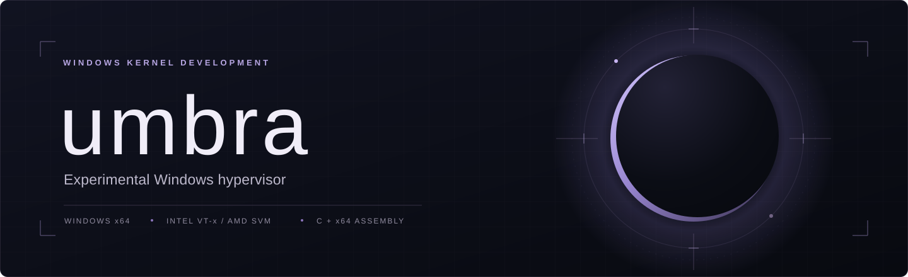

<p align="center">
  
</p>

<h1 align="center">umbra</h1>

<p align="center">
  <strong>An experimental Windows hypervisor for Intel VT-x and AMD SVM.</strong>
</p>

<p align="center">
  <code>Windows x64</code> &nbsp;·&nbsp; <code>C + x64 assembly</code> &nbsp;·&nbsp; <code>VT-x / SVM</code> &nbsp;·&nbsp; <a href="LICENSE">MIT licensed</a>
</p>

<p align="center">
  <a href="#1-overview">Overview</a> &nbsp;·&nbsp;
  <a href="#2-architecture">Architecture</a> &nbsp;·&nbsp;
  <a href="#4-building">Build</a> &nbsp;·&nbsp;
  <a href="#5-evaluation">Evaluation</a> &nbsp;·&nbsp;
  <a href="#6-limitations-and-future-work">Limitations</a>
</p>

---

> [!WARNING]
> **Experimental kernel code.** The driver can hang or crash the system. Startup and shutdown handling are incomplete, and some exit paths deliberately bugcheck. Test on a machine you can recover.

## Abstract

**umbra** is a Windows kernel-mode hypervisor project with Intel VT-x and AMD SVM backends, written in C and x64 assembly.

The code covers processor setup, guest entry and exit handling, identity-mapped EPT/NPT, CPUID handling, and an Intel-side timing experiment. A separate user-mode tool, `hvprobe`, checks selected CPUID responses, instruction timing, TSC ordering, and VMCALL fault behaviour.

Both backends are still in bring-up. The launch paths are in source, but the default build stages stop before guest execution. See [implementation status](#3-implementation-status) for the current settings.

## Contents

1. [Overview](#1-overview)
2. [Architecture](#2-architecture)
3. [Implementation status](#3-implementation-status)
4. [Building](#4-building)
5. [Evaluation](#5-evaluation)
6. [Limitations and future work](#6-limitations-and-future-work)
7. [Contributing](#7-contributing)
8. [License](#8-license)

## 1. Overview

### Guest-visible state

CPUID responses, control-register shadows, MSR values, exceptions, and timing need to agree with the processor state the guest expects. This project focuses on those interactions. Changing a reported feature without accounting for related register behaviour, for example, can produce conflicting results.

### Implementation approach

| Area | Approach |
| :--- | :--- |
| **CPUID** | Cache selected leaf/subleaf pairs before backend initialization; use the same handler on VMX and SVM. |
| **Source layout** | Keep allocation, paging, processor setup, exit dispatch, timing, and diagnostics in separate files. |
| **Backends** | Use separate VMX and SVM entry paths with shared vCPU structures and CPUID handling. |
| **Bring-up** | Stop at compile-time checkpoints to test individual processor transitions. |
| **Measurements** | Use a separate user-mode probe for CPUID responses, timing, TSC ordering, and instruction exceptions. |

### Scope

The project uses a Windows driver rather than a bootloader. It does not include guest OS installation, device emulation, or a VM management interface. Hyper-V coexistence is not implemented.

## 2. Architecture

### Execution model

The driver selects a backend from the processor vendor, captures selected CPUID responses, allocates processor-local resources, and builds the corresponding identity map. Backend-specific code then performs the transitions allowed by the selected build stage.

```text
                     Windows driver entry
                              |
                       Vendor selection
                              |
                +-------------+-------------+
                |                           |
          Intel VT-x                    AMD SVM
          VMXON / VMCS                 HSAVE / VMCB
          EPT identity map             NPT identity map
                |                           |
          VMX assembly stubs            SVM assembly loop
                |                           |
          VM-exit dispatch              SVM-exit dispatch
                |                           |
                +-------------+-------------+
                              |
                  Shared vCPU / CPUID model

        hvprobe: a separate user-mode observation tool
```

The diagram shows the code structure. Full launch-and-teardown cycles still need hardware validation.

### Backend comparison

| Area | Intel VT-x | AMD SVM |
| :--- | :--- | :--- |
| **Processor context** | VMXON region, VMCS, host stack, MSR bitmap, and per-vCPU VPID | Guest and host VMCBs, host-save area, MSR permission map, and per-vCPU ASID |
| **CPUID** | Shared cache for selected leaf/subleaf pairs; uncached requests execute CPUID directly | Same shared handler and cache |
| **Second-level translation** | Identity EPT with 2 MiB leaves; captured RAM ranges guide WB/UC memory-type selection | Identity NPT with 2 MiB leaves |
| **Guest-visible state** | CR4 mask/read-shadow setup and VMX instruction exception handlers | EFER interception and a guest EFER shadow |
| **Timing experiment** | Calibrated CPUID cost and a one-shot RDTSC interception path | No corresponding timing-compensation path in the current backend |
| **Exit handling** | CPUID, RDTSC, control-register access, hypercalls, VMX instructions, and XSETBV | CPUID, MSR access, hypercalls, VMRUN, and nested-page faults |
| **Diagnostics** | Debug messages, registry status values, and explicit bugcheck paths | Shared status channel with SVM-specific checkpoints and bugcheck paths |

Exit handling is incomplete. Both paging builders also size their identity maps from the reported physical-address width, which can require large contiguous allocations.

### Source map

```text
umbra-hv/
├── assets/                   README artwork
├── hv/
│   ├── asm/
│   │   ├── hv.asm            VMX entry, exit, and teardown stubs
│   │   └── svm_entry.asm     SVM entry and execution loop
│   ├── include/              Shared types and VMX/SVM definitions
│   ├── src/
│   │   ├── driver.c          Driver lifecycle and backend selection
│   │   ├── vcpu.c            Processor-local resource allocation
│   │   ├── vmx.c, vmcs.c     Intel enablement and VMCS setup
│   │   ├── svm.c             AMD enablement, VMCB setup, and exits
│   │   ├── ept.c, npt.c      Second-level identity maps
│   │   ├── exits.c           Intel VM-exit dispatch
│   │   ├── cpuid.c, tsc.c    CPUID policy and Intel timing experiment
│   │   └── status.c          Registry-backed bring-up checkpoints
│   ├── umbra.inf             Driver installation metadata
│   └── umbra.vcxproj         WDK project
├── tools/hvprobe/hvprobe.c   User-mode observation tool
└── LICENSE
```

**Suggested reading order:** [driver lifecycle](hv/src/driver.c) → [vCPU allocation](hv/src/vcpu.c) → [Intel setup](hv/src/vmx.c) or [AMD setup](hv/src/svm.c) → [exit handling](hv/src/exits.c) → [probe implementation](tools/hvprobe/hvprobe.c).

## 3. Implementation status

VMX and SVM launch stubs and exit handlers are in source. Hardware testing is incomplete, and the repository does not include cross-machine test results or benchmark data.

### Compile-time stages

The current defaults are **`HV_STAGE=3`** in [hv.h](hv/include/hv.h) and **`HV_SVM_STAGE=1`** in [svm.c](hv/src/svm.c). **Neither default reaches guest launch.**

`HV_STAGE < 1` returns from driver entry without backend initialization. Otherwise, the selected backend follows its own path:

| Backend | Stage | Current code path |
| :--- | :--- | :--- |
| Intel | `HV_STAGE=1` | Capture CPUID, calibrate timing, and allocate vCPU resources and EPT; skip VMX enablement. |
| Intel | `HV_STAGE=2` or `3` | Add capability checks and a VMXON/VMXOFF round trip. |
| Intel | `HV_STAGE=4` | Add VMCS setup, then leave VMX operation without launching a guest. |
| Intel | `HV_STAGE>=5` | Reach the VMLAUNCH path. |
| AMD | `HV_SVM_STAGE<=1` | Check SVM support and write `VM_HSAVE_PA`; return before setting `EFER.SVME`. |
| AMD | `HV_SVM_STAGE=2` | Additionally set and clear `EFER.SVME`; return before VMCB setup and launch. |
| AMD | `HV_SVM_STAGE>=3` | Configure the VMCBs and reach the VMRUN path. |

> [!IMPORTANT]
> Lower stages are not necessarily safe to load or unload. The first SVM stage already writes a privileged MSR, and the shutdown code does not fully account for which stage ran.

### Hardware observations

During earlier AMD testing under VMware Workstation 17, the guest advertised SVM support but stalled on a `VM_HSAVE_PA` write before guest launch. This was reported on the development setup; it has not been established as a general VMware limitation. The repository does not include a standalone reproducer.

## 4. Building

### Prerequisites

- Windows x64 with a Visual Studio C++ development environment.
- A Windows SDK and WDK installation providing the `WindowsKernelModeDriver10.0` toolset.
- MSBuild and the x64 MASM build integration available to the project.
- An x64 developer shell for compiling the user-mode probe with `cl`.

Runtime tests need the relevant CPU features enabled in firmware. Hyper-V/VBS coexistence is not implemented. Test nested virtualization separately from bare metal.

### Driver

From the repository root in a **Visual Studio Developer PowerShell** session:

```powershell
$repo = (Get-Location).Path

msbuild .\hv\umbra.vcxproj /m `
  /p:Configuration=Release `
  /p:Platform=x64 `
  "/p:SolutionDir=$repo/"
```

Setting `SolutionDir` keeps the build output under the repository root: `build/Release/` for output and `build/Release/obj/` for intermediates. The project declares `Release|x64` and `Debug|x64` configurations.

**Driver signing is disabled in the project.** Sign the output for your driver-test environment before loading it. The build step does not install or load the driver.

### User-mode probe

From the repository root in the same x64 developer shell:

```powershell
New-Item -ItemType Directory -Force .\build | Out-Null

cl /nologo /O2 /W4 .\tools\hvprobe\hvprobe.c `
  /Fe:.\build\hvprobe.exe `
  /Fo:.\build\hvprobe.obj
```

The probe builds separately from the driver and uses Windows APIs and compiler intrinsics. Its VMCALL test only handles illegal-instruction exceptions; other fault types can terminate it.

## 5. Evaluation

### What hvprobe observes

[hvprobe](tools/hvprobe/hvprobe.c) runs six checks. It returns `0` if all pass, or `1` if any fail.

| Observation | Pass condition | Notes |
| :--- | :--- | :--- |
| **Hypervisor-present bit** | CPUID leaf 1, ECX bit 31 is clear | Checks one CPUID bit. |
| **Hypervisor signature leaf** | All-zero response at `0x40000000` in the probe's normal branch | Unsupported leaves do not return zero on every processor. |
| **Invalid-leaf consistency** | Responses at `0x40000001` and `0x4FFFFFFF` match | Compares two leaf numbers, not the full CPUID interface. |
| **CPUID timing** | Estimated net cost below 400 TSC ticks | The threshold is hard-coded. Compare with the same machine's baseline. |
| **TSC ordering** | Strictly increasing sampled reads across 10,000 CPUID iterations | Tests local ordering only, not cross-core clock behaviour. |
| **Ring-3 VMCALL** | An illegal-instruction exception is observed | Other exception types are not fully handled. |

The probe can pass without umbra loaded. It does not confirm guest launch or test backend equivalence, all kernel-visible state, cross-core timing, interrupt delivery, or teardown.

### Testing procedure

1. Record the commit, CPU, firmware, Windows build, toolchain, stage values, processor count, and any outer hypervisor or VBS configuration.
2. Run the probe several times without umbra and save the complete output as a baseline.
3. Test one backend and bring-up stage at a time.
4. Use debugger output and driver checkpoints to check which stage ran. A successful driver load does not confirm guest launch.
5. Repeat timing measurements and keep the individual results, including outliers.
6. Report allocation, enablement, launch, sustained execution, and teardown results separately.

### Bring-up diagnostics

[status.c](hv/src/status.c) writes a `Status` DWORD under the registry path supplied to `DriverEntry`. Values requested above `PASSIVE_LEVEL` are deferred until `hv_status_flush()` writes them. It records the last committed checkpoint; a crash can occur before a pending value is flushed.

Debug messages use the `[hv]` prefix. Unexpected exits and translation faults can trigger bugchecks with diagnostic parameters. Check the relevant backend source and build stage when interpreting a status value or crash.

## 6. Limitations and future work

Known gaps:

- **Lifecycle correctness:** stage-aware teardown, partial-initialization rollback, and repeatable launch/unload testing.
- **Processor topology:** the allocation limit is 64 vCPUs; processor-group handling and all-processor launch require further work. The Intel initialization path currently starts the calling processor rather than using its all-CPU bring-up helper.
- **Architectural coverage:** broader instruction, exception, MSR, control-register, and interrupt/NMI validation.
- **Memory translation:** allocation scalability, memory-type correctness, and validation across RAM and MMIO layouts.
- **Backend parity:** separate measurements for VMX and SVM rather than assuming shared policy produces identical behaviour.
- **Compatibility:** no implemented Hyper-V coexistence or general nested-virtualization support guarantee.
- **Research extensions:** EPT dual-view hooks and CR3-scoped filtering are not implemented.

## 7. Contributing

Keep changes focused. For behaviour changes, describe what changed and include a small test or reproducer.

For bug reports and test results, include:

- The commit and the smallest relevant source change.
- Hardware, firmware, OS, toolchain, and outer-hypervisor details.
- The selected backend and compile-time stage values.
- Reproduction steps, baseline and observed output, and available checkpoint or bugcheck data.
- Whether the failure occurs during allocation, enablement, launch, execution, or teardown.

Please remove credentials, private paths, and unrelated system data from diagnostic material before publishing it. Keep experiments on systems you own or are authorized to test.

## 8. License

Distributed under the [MIT License](LICENSE). See the license file for the copyright notice and full terms. The software is provided without warranty.
